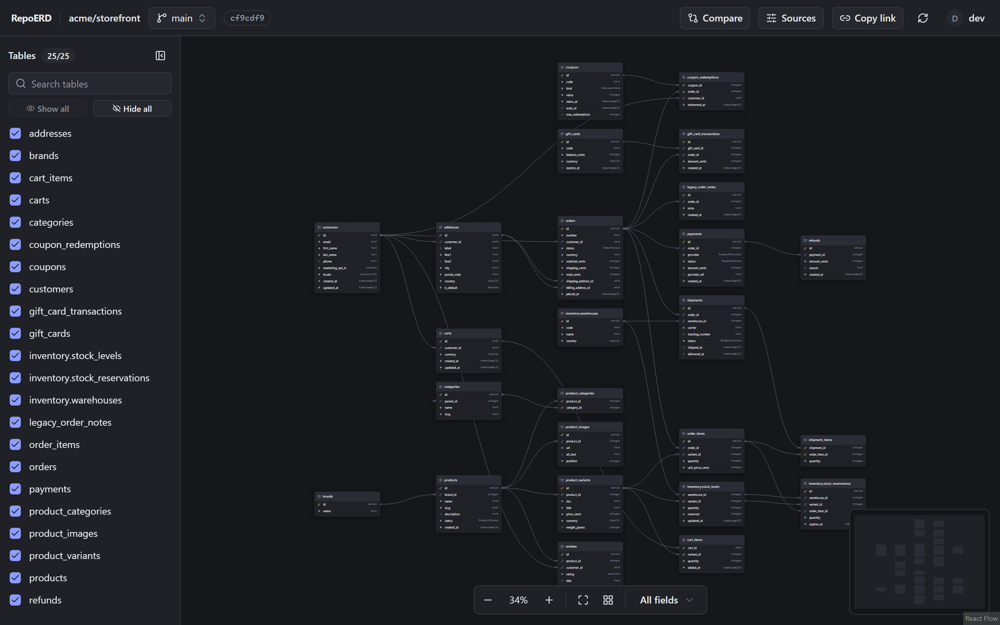
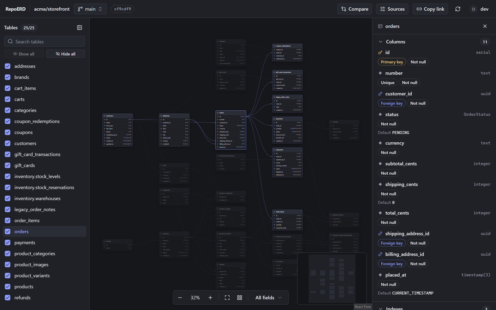
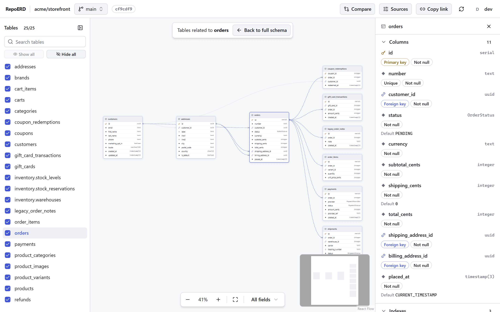
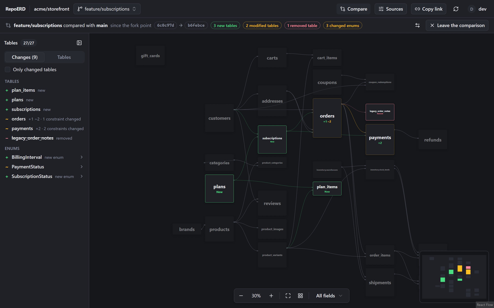
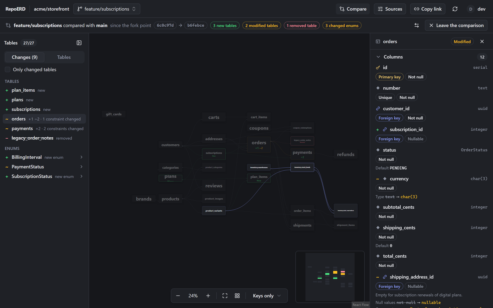
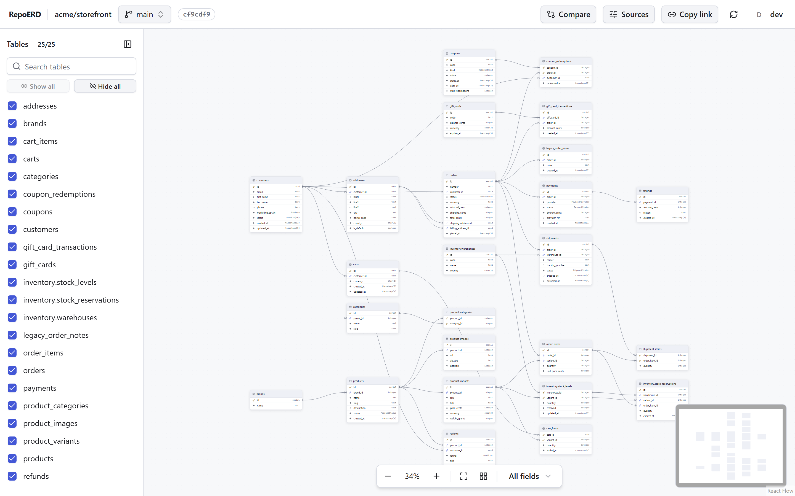

# RepoERD

RepoERD is a self-hosted web app that shows the database schema of your GitHub repositories as an entity-relationship diagram, branch by branch. It reads Prisma and Drizzle (PostgreSQL) schemas straight from the code: nothing to install in your projects, no connection to a database. Everyone arranges the tables as on a whiteboard, and RepoERD shows what a branch changes in the schema before you merge it.



## Features

- **Finds the schemas by itself**, on any branch. Prisma: a `schema.prisma`, a `prisma/` folder with `models/`, multi-file schemas, `prisma.config`, Prisma 7. Drizzle: `drizzle.config.*`, barrels and relative imports, `tsconfig` path aliases, workspace packages, `casing`. Monorepos with several schemas get a source picker, and when detection is not enough, the sources of a repository can be declared by hand (files, folders or globs).
- **A diagram you arrange.** Table positions are saved on the server per user, repository, source and display mode: your moves never change anyone else's layout. New tables are placed next to the existing ones automatically.
- **Three display modes** (all columns, keys only, table names only) and a semantic zoom that keeps only the names when you zoom out on a large schema.
- **Table details**: columns (type, primary and foreign keys, nullability, defaults, comments), indexes, constraints with `ON DELETE` / `ON UPDATE`, and a "related tables" view that lays out a table with its direct neighbours.
- **Branch comparison**: what a branch changes in the schema — tables, columns, indexes, constraints, relationships and enums added, removed or modified, with every value before → after — from its fork point like a pull request, or directly between two branches. A list of changes, and a link to share.
- **PostgreSQL schemas and keys**: tables outside `public` (Prisma `@@schema`, Drizzle `pgSchema`) are named `schema.table`; composite primary and foreign keys are drawn as such; views are counted, not drawn.
- **Shareable links**: the branch, source, comparison, selected table, hidden tables and display mode are in the URL.
- **Access follows GitHub**: people see only the repositories they can reach through the GitHub App, and changing the sources of a repository needs push access. Sign-in can be restricted to some organisations; administrators manage the instance from `/admin`.
- English and French, light and dark themes, a keyboard-friendly table list.

| Table details | Related tables |
|---|---|
|  |  |
| **Comparing a branch with main** | **A modified table, before → after** |
|  |  |



## Try it in demo mode

The demo mode serves example repositories (among them the Prisma and Drizzle showcases of the screenshots) and never contacts GitHub:

```bash
docker run --rm -p 3000:3000 -e GITHUB_MODE=fake \
  -e SECRET_KEY=demo-only-secret-key-0123456789abcdef ghcr.io/b4b0u/repoerd:0.1
```

Then open <http://localhost:3000>: you are signed in as the demo user `dev`.

> **Never use the demo mode for real work.** There is no sign-in: every visitor is an administrator, and the server says so in its logs at start-up. Keep it on your own machine. A database used in demo mode cannot be opened in real mode (nor the reverse): give each mode its own `DATABASE_PATH`.

## Install

You need Docker with Compose, a host name served over HTTPS by a reverse proxy, and a GitHub account or organisation where you can create a GitHub App.

1. Copy [`docker-compose.yml`](docker-compose.yml) to your server and create a `.env` file next to it with a secret key of 32 characters or more:

   ```bash
   echo "SECRET_KEY=$(openssl rand -base64 32)" > .env
   ```

2. Start it:

   ```bash
   docker compose up -d
   ```

3. Put a reverse proxy in front of it (below). The compose file publishes port 3000 on `127.0.0.1` only, so a proxy on the same host reaches it; change the `ports` entry if your proxy runs elsewhere.
4. Open `https://<your host>/setup` and enter the one-time code printed in the logs (`docker compose logs repoerd`).
5. Create the GitHub App from that page (or enter the credentials of an existing one), then install it on the organisations or repositories you want to show.
6. Sign in with GitHub. The person who completed the setup becomes the first administrator.

### Reverse proxy: HTTPS is required

RepoERD's cookies are `Secure`: outside `localhost`, sign-in only works over HTTPS. The proxy must terminate HTTPS and send `X-Forwarded-Proto: https`.

[Caddy](https://caddyserver.com/) obtains the certificate and sets the header by itself:

```caddyfile
erd.example.com {
	reverse_proxy 127.0.0.1:3000
}
```

nginx:

```nginx
server {
    listen 80;
    server_name erd.example.com;
    return 301 https://$host$request_uri;
}

server {
    listen 443 ssl http2;
    server_name erd.example.com;

    ssl_certificate     /etc/letsencrypt/live/erd.example.com/fullchain.pem;
    ssl_certificate_key /etc/letsencrypt/live/erd.example.com/privkey.pem;

    # Layouts of very large schemas are sent in one request (RepoERD accepts up to 4 MiB).
    client_max_body_size 5m;

    location / {
        proxy_pass http://127.0.0.1:3000;
        proxy_set_header Host $host;
        proxy_set_header X-Forwarded-Proto $scheme;
        proxy_set_header X-Forwarded-For $proxy_add_x_forwarded_for;
    }
}
```

### The GitHub App

The setup page creates a **private** GitHub App with read-only permissions on **Contents** and **Metadata**, and no webhook. A private App can only be installed on the account that owns it: create it under your organisation (the default choice) to show the organisation's repositories. Its callback URL is `<public URL>/auth/callback`. RepoERD reads repository contents with the App's installation tokens, and uses each person's GitHub sign-in only to know which repositories they may see.

GitHub Enterprise Server is not supported: RepoERD talks to github.com only.

## Configuration

| Variable | Description |
|---|---|
| `SECRET_KEY` | Required, at least 32 characters with at least 8 different ones; outside demo mode, the example keys published in this repository are refused. Encrypts the GitHub App secrets and the user tokens (it does not sign sessions): keep it for the life of the database. With another key the server refuses to start (`The SECRET_KEY does not match the one this database was created with, or a stored secret is corrupted`); to move to a new key, see [Recovery](#recovery). |
| `DATABASE_PATH` | SQLite file. Default: `/data/repoerd.sqlite`. |
| `PORT` | HTTP port. Default: `3000`. |
| `GITHUB_MODE` | `real` (default) or `fake` (demo mode). |
| `FIXTURES_PATH` | Example repositories of the demo mode. Set in the image. |
| `WEB_DIST_PATH` | Folder of the web build. Set in the image; empty means API only. |
| `REPOERD_VERSION` | Version reported by `/healthz` and by every API answer. Set when the image is built: do not override it at run time, or every open tab would offer to reload. |

The public URL, the allowed organisations and the administrators are set in the app (`/setup`, `/admin`).

## Data and privacy

The whole state is the SQLite file in `/data` (the `repoerd-data` volume). It holds:

- the users (GitHub id, login, avatar URL, administrator flag, last activity) and their sessions (only a hash of each session token);
- the GitHub App credentials and each user's GitHub tokens, **encrypted** with `SECRET_KEY` (AES-256-GCM);
- the layouts and the manual sources of each repository;
- caches: the contents of the schema files people open, the detected sources and the parsed schemas. Cached data older than **30 days** is deleted at start-up and every day.

Sessions last 30 days from the last visit, and 90 days at most after the sign-in. The code of the repositories is never executed: schema files are parsed in separate processes, with size and nesting limits. RepoERD sends no data anywhere but to GitHub.

## Backups and upgrades

**Back up before every upgrade.** Database migrations run at start-up and cannot be undone: an older image does not run on a database that a newer one migrated. To go back, restore the backup taken before the upgrade and run it with the older image.

- **Stopped container:** copy `repoerd.sqlite`. The write-ahead log is checkpointed on a clean stop; copy the `-wal` and `-shm` files too if they are present.
- **Running container:** find the volume on the host (`docker volume ls`, then `docker volume inspect <volume> --format '{{ .Mountpoint }}'`), run `sqlite3 <that folder>/repoerd.sqlite ".backup backup.sqlite"` there (`sqlite3` is not in the image), then copy `backup.sqlite`.

If you use a host bind mount instead of the named volume, the folder must be writable by uid 1000 (`chown 1000:1000 <folder>`), since the image runs as the `node` user.

`docker-compose.yml` pins the `0.1` line (`ghcr.io/b4b0u/repoerd:0.1`): `docker compose pull && docker compose up -d` then brings patch releases of 0.1 only. To move to a new minor version, back up, change the tag on purpose (read the [changelog](CHANGELOG.md) first), and recreate the container. Images are published as `X.Y.Z`, `X.Y`, `X` (from 1.0 on) and `latest`. `/healthz` reports the running version.

## Recovery

The image ships a `repoerd-admin` command for what the web interface cannot fix. It reads the same database (`DATABASE_PATH`) and needs no `SECRET_KEY`: no command reads or writes a secret.

While the server runs:

```bash
docker compose exec repoerd repoerd-admin <command>
```

`docker compose exec` runs the command in the running container, so it always uses the image of the server you are running. `docker compose run --rm` uses the image last pulled, so do not pull a newer image before running it: a newer `repoerd-admin` would apply newer database migrations under an older server.

When the server cannot start (for example after a `SECRET_KEY` change), run it in a one-off container:

```bash
docker compose run --rm repoerd repoerd-admin <command>
```

| Command | Effect |
|---|---|
| `list-admins` | Lists the administrators. |
| `promote <login>` | Makes a user who signed in once an administrator, at once. Use it when the last administrator left or lost their GitHub access: `/admin` never removes the last administrator. |
| `set-public-url <url>` | Changes the public URL (validated as in `/admin`). Restart the container to apply, and declare `<url>/auth/callback` in the GitHub App. |
| `set-allowed-orgs [org ...]` | Restricts sign-in to these GitHub organisations (validated as in `/admin`); with no organisation, removes the restriction. Use it when nobody can sign in because the GitHub App is not installed on an allowed organisation. Restart the container to apply. |
| `reset-app` | Forgets the GitHub App, the users' GitHub tokens and every session. Layouts, repository settings, administrators, allowed organisations and the public URL are kept. Restart the container: it prints a new setup code, then open `/setup` to register a GitHub App again (the instance is ready as soon as the App is saved). |

**Changing `SECRET_KEY`.** A key that does not open the stored secrets stops the server, and outside demo mode a published example key or a weak key is refused. Restore the original key, or start over with the GitHub App:

1. Put a new key in `.env` (`openssl rand -base64 32`).
2. `docker compose run --rm repoerd repoerd-admin reset-app`
3. `docker compose up -d`, read the setup code in `docker compose logs repoerd`, and open `/setup`.

While you can still sign in, the App can also be replaced from `/admin` ("Replace the GitHub App"), for example after rotating its private key or client secret on GitHub: everyone is signed out and signs in again. If sign-in is restricted to organisations, install the new App on them before signing in (or lift the restriction with `repoerd-admin set-allowed-orgs` and restart).

## Known limitations

**Scope**

- GitHub.com only: GitHub Enterprise Server is not supported.
- PostgreSQL only. A Drizzle config with another `dialect` is reported as unsupported.
- One server instance: rate limits, the parsing queue and the repository visibility caches live in memory.
- Image size is about 460 MB (the parser ships native binaries).

**Parsing**

- Prisma schemas are read with Prisma 6.8 (the version the parser embeds): a newer construct may be refused, with Prisma's message. `map:` is not taken into account for the names of Prisma indexes.
- Drizzle: spread columns (`...timestamps`) are read only from a top-level object literal of the source (not from a function call or a computed object); `casing` is read from `drizzle.config` only (not the one passed to `drizzle()` at run time); `pgTableCreator` and the `pgTable(name, (t) => ({ … }))` form are not read; default names of indexes and constraints are computed before the casing; an old drizzle-kit `driver` without `dialect` is not reported; manual sources do not apply the `casing` of the `drizzle.config`; the text of a `check()` keeps the JavaScript names under `casing`; `foreignColumns` written through a namespace import are ignored; default foreign key names follow the JavaScript variable of the target table (renaming the variable renames the key; the comparison pairs them); an index rename is shown when a table switches between the object and array extra-config forms.
- Two files of the same source that declare a variable with the same name: references may resolve to the wrong table.
- A `drizzle.config` with several `module.exports` / `export default`: the first one is read (at run time, it is the last one).
- Imports: an `extends` pointing to an npm package (`@tsconfig/…`) is not followed; at most 200 `package.json` files are read to find the workspace packages.
- The nesting limit is an estimate: a regular expression with many parentheses can get a file refused.
- A repository tree that GitHub truncates (over 100,000 entries or 7 MB) gives a partial detection, which manual sources cannot fix.
- Globs differ from picomatch in exotic cases (`*/**` against a file at the root, `**.ts` within a segment).
- Views are neither drawn nor compared; in a comparison, only the views of the compared branch are counted.

**Diagram and comparison**

- The default display mode switches to table names above 30 tables, and the choice is not remembered.
- A rename (table, column, index) is shown as a removal plus an addition; only a foreign key whose generated name changed, with the same columns and target, is recognised.
- Only branches can be compared. When GitHub cannot compute a fork point (unrelated histories), only the direct comparison works.
- Table names of 40 characters or more stay small in the overview; in the light theme, dimmed cards are pale.
- Links with many hidden tables use a compact form that only applies to the same set of tables: on another branch, or in a comparison, it is ignored (nothing hidden).
- The browser's Back button does not ask before leaving unsaved changes to manual sources.
- A layout is carried over to a moved source only between detected sources; a manual source neither passes on nor takes over a layout.

**Administration**

- `repoerd-admin set-public-url`, `set-allowed-orgs` and `reset-app` take effect at the next restart.
- After replacing the App or a `reset-app`, the organisation restriction stays: only users with access to an installation of the new App can sign in. An App whose client secret was revoked cannot be used to sign in any more: the way out is `reset-app`.
- Several former holders of the same GitHub login all appear as former logins.
- In demo mode there is no rate limit: every visitor shares the same user.

## Development

See [CONTRIBUTING.md](CONTRIBUTING.md): setup, commands, architecture rules and release procedure.

```bash
pnpm install
pnpm dev      # API on http://localhost:3100 in demo mode + web on http://localhost:5173
pnpm verify   # lint, types, tests, architecture rules, build, bundle budget
pnpm e2e      # production build + Playwright tests
```

Report vulnerabilities privately: see [SECURITY.md](SECURITY.md). Everyone taking part follows the [code of conduct](CODE_OF_CONDUCT.md).

## Acknowledgements

- [Liam ERD](https://github.com/liam-hq/liam): RepoERD parses schemas with its `@liam-hq/schema` package (Apache 2.0, used in a modified version: see [THIRD_PARTY_NOTICES.md](THIRD_PARTY_NOTICES.md)), and its table cards inspired RepoERD's.
- [dbdiagram.io](https://dbdiagram.io): an inspiration for the diagram.

## License

[MIT](LICENSE) © 2026 Baptiste Coconnier. Third-party notices: [THIRD_PARTY_NOTICES.md](THIRD_PARTY_NOTICES.md).
